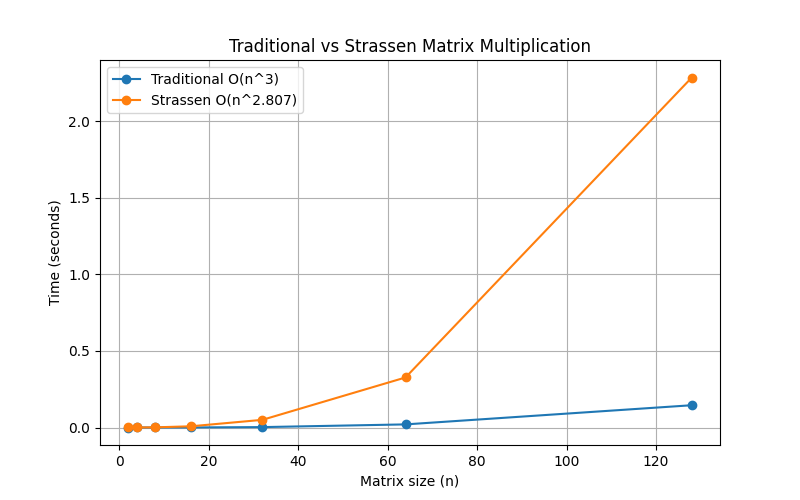
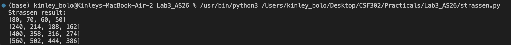
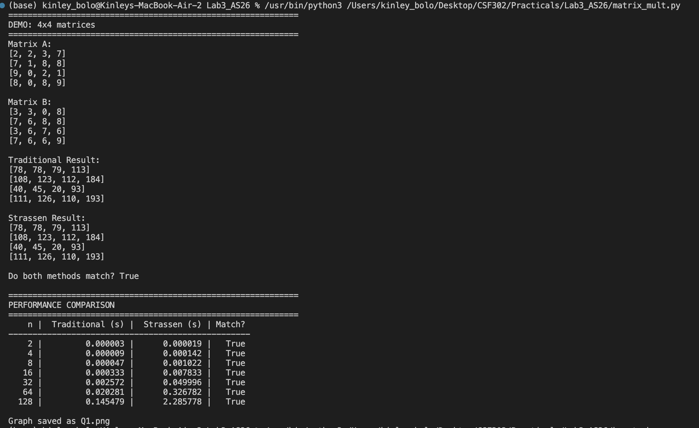
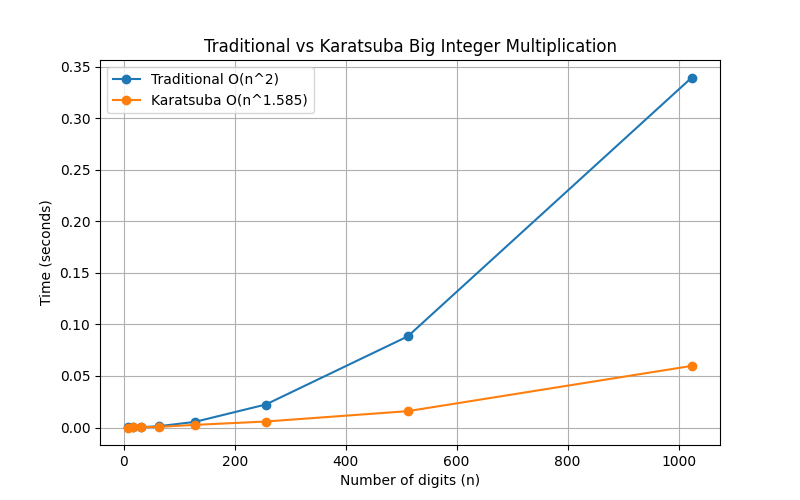
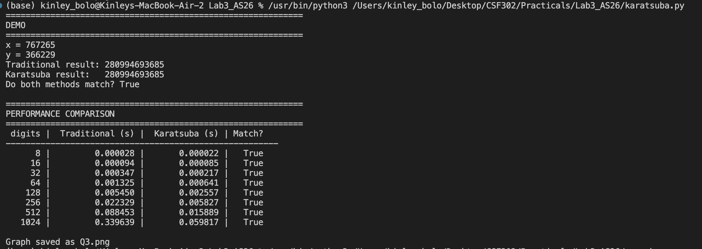
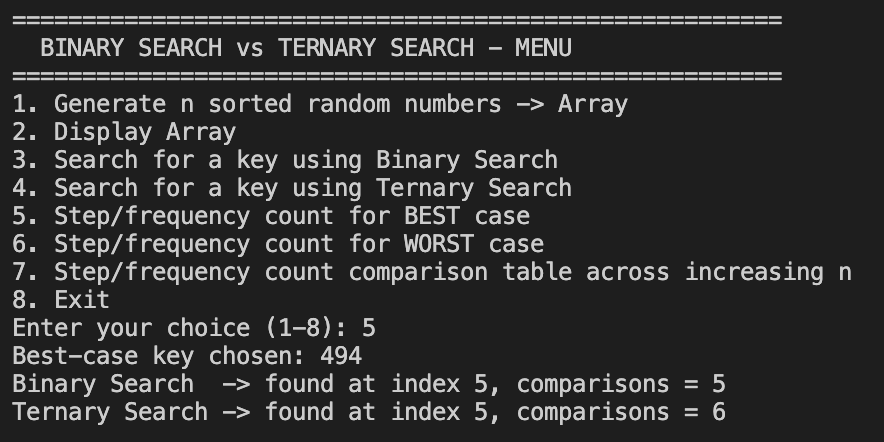
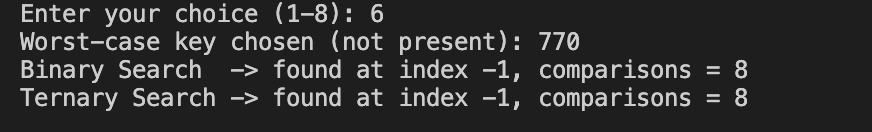
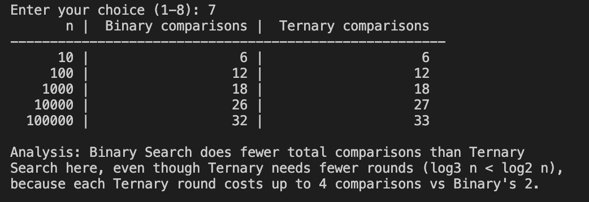

# Lab 3 — Divide and Conquer Algorithms

## 1. Aim

We aim to implement and compare three pairs of algorithms — one traditional
and one divide-and-conquer — for matrix multiplication, large integer
multiplication and searching and to study how their theoretical time
complexities relate to their actual measured performance.

## 2. Objectives

- We aim to implement Traditional matrix multiplication (O(n³)) and
  Strassen's Algorithm (O(n^2.807)), verify that both produce identical
  results and compare their running times across increasing matrix sizes.
- We aim to implement Traditional grade-school multiplication (O(n²)) and
  Karatsuba's Algorithm (O(n^1.585)) for large integers, verify that both
  produce identical results and compare their running times across
  increasing digit counts.
- We aim to implement Binary Search (O(log₂n)) and Ternary Search
  (O(log₃n)) and analyze their best-case, worst-case, and total
  comparison counts across increasing array sizes.
- We aim to record our results in tables and graphs and to relate the
  observed performance back to each algorithm's recurrence relation.

## 3. Steps

### Q1 — Matrix Multiplication (`matrix_mult.py`, `strassen.py`)

1. We implemented `traditional_multiply()` using a triple nested loop.
2. We implemented `strassen_multiply()` in `strassen.py`, splitting each
   matrix into 4 quadrants and combining 7 recursive multiplications
   instead of 8.
3. We generated random n × n matrices for n = 2, 4, 8, 16, 32, 64, 128
   (powers of 2, as required).
4. We ran both algorithms on the same matrices, timed each run and
   verified the two results matched at every size.
5. We plotted a time-vs-size graph for both methods and saved it as
   `Q1.png`.

**Q1-Output:**

### Q2 — Karatsuba's Algorithm (`karatsuba.py`)

1. We implemented a digit-by-digit `traditional_multiply()` that mimics
   grade-school long multiplication.
2. We implemented `karatsuba()`, splitting each number into a high and
   low half and combining 3 recursive multiplications instead of 4.
3. We generated random integers with 8, 16, 32, 64, 128, 256, 512 and
   1024 digits.
4. We ran both algorithms on the same numbers, timed each run, and
   verified the two results matched at every size.
5. We plotted a time-vs-digit-count graph and saved it as
   `Q2.png`.

**Q2-Output:**

### Q3 — Binary Search vs Ternary Search (`search.py`)

1. We built a menu-driven program with options to generate a sorted
   array, display it, search using either algorithm and view step
   counts.
2. We implemented `binary_search()` and `ternary_search()`, each
   returning both the index found and the number of comparisons made.
3. We tested the best case (key found immediately), the worst case (key
   absent), and a comparison table across n = 10, 100, 1,000, 10,000
   and 100,000.
4. We related the observed comparison counts back to the recurrence
   relations T(n) = T(n/2) + O(1) for Binary Search and
   T(n) = T(n/3) + O(1) for Ternary Search.

**Q3-Output:**

## 4. Conclusion

We confirmed, for all three problems, that the divide-and-conquer method
and the traditional method always produced matching results, which
validates our implementations.

For matrix multiplication, we found that Strassen's Algorithm was
consistently *slower* than the traditional method within our test range
(for example, at 128×128, traditional took about 0.078s while Strassen
took about 1.53s). We attribute this to the recursion and the many extra
matrix additions/subtractions Strassen performs at every level, which in
pure Python outweigh its lower asymptotic multiplication count until the
matrices get much larger than what we tested.

For large integer multiplication, we found the opposite trend: Karatsuba
pulled further ahead of the traditional method as the digit count grew,
matching the O(n^1.585) vs O(n²) theory (at 1024 digits, traditional took
about 0.241s while Karatsuba took about 0.026s — roughly a 9x speedup).

For searching, we found that Binary Search made fewer or equal total
comparisons compared to Ternary Search at every array size we tested,
even though Ternary Search needs fewer recursive rounds. We concluded
this is because each Ternary Search round can cost up to 4 comparisons
versus Binary Search's 2, so the extra per-round work outweighs the
benefit of having fewer rounds.

Overall, this lab showed us that asymptotic complexity is a useful guide
but doesn't always predict real-world performance directly — constant
factors and implementation overhead (recursion, extra arithmetic, extra
comparisons) can matter a great deal at the input sizes typically used
in practice.
